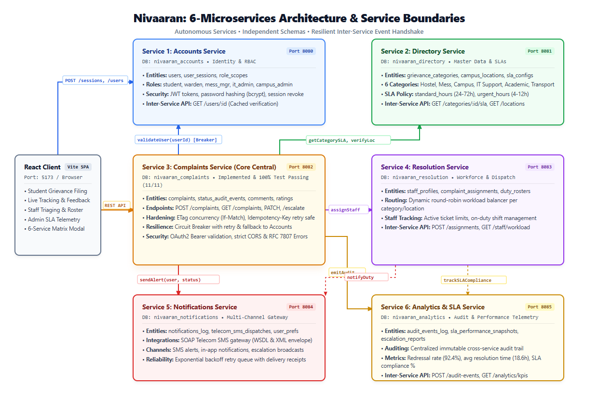

# Nivaaran

A grievance redressal platform for the IIIT Vadodara campus. Students report mess, hostel and general campus issues in one place and follow each complaint until it is fixed. Wardens, mess in-charges and maintenance staff resolve complaints in their area. Admins watch deadlines, escalations and overall numbers.

*Nivaaran* means "remedy" or "redress".

Everything in this project is a REST API with JSON over HTTP, described by OpenAPI. The backend is split into small services that each own their data, and the frontend is a React app.

## Submission Deliverables & Links

- **GitHub Repository:** [https://github.com/01-Aarambhika/nivaaran.git](https://github.com/01-Aarambhika/nivaaran.git)
- **Working Video Demonstration:** [Google Drive Demo Folder](https://drive.google.com/drive/folders/1jHVG6UMFhs6dGk2d55Yz0GA3Q7jfSy3L?usp=drive_link) (Access: *"Anyone with the link"*)
- **Complete Submission Report:** [`ReadMe.pdf`](ReadMe.pdf) (Covers all questions for Assignments 01 to 06)

## Team

| Roll no | Name | Responsibility |
|---|---|---|
| 20251651001 | Aarambhika | Accounts service |
| 20251651006 | Abhishek   | Complaints service |
| 20251651078 | Ritik      | Complaints service |
| 20251651078 | Ritik      | React client |
| 20251651006 | Abhishek   | React client |


## What it does

- Students sign up with their roll number, log in, and file complaints about the mess, hostels or the wider campus. A complaint can be anonymous.
- Every complaint has a category, a location, a priority and a resolution deadline.
- Staff and admins assign, update, escalate and resolve complaints. Every change is kept in a status history.
- Students can comment, rate the result, or reopen a complaint that is not really fixed.
- If a deadline passes, the student or an admin can escalate the complaint.

## Roles and login

Every person signs in with a **User ID and a password**. The role belongs to the account and is decided by the server, never by the client.

| Role | User ID is | Account created by | Can do |
|---|---|---|---|
| Student | Roll number | The student, by signing up | File complaints, see own complaints, comment, withdraw, rate or reopen, escalate once overdue |
| Hostel warden | Staff ID | Admin | See hostel complaints, start work, mark resolved, comment |
| Mess in-charge | Staff ID | Admin | Same, for mess complaints |
| Maintenance staff | Staff ID | Admin | Same, for campus complaints |
| Admin | Staff ID | Seeded on first run | Everything above, plus creating staff accounts, assigning and escalating |

A successful login returns a signed token (JWT). The client sends it as `Authorization: Bearer <token>` and every service checks it.

## Architecture

The full architecture consists of **six microservices**. Each microservice strictly owns its database boundary, ensuring loose coupling and isolated failure domains:

| # | Service | Port | Database | Owns | Status |
|---|---|---|---|---|---|
| 1 | **Accounts** | `8080` | `nivaaran_accounts` | users, roles, login, sessions | Designed / Simulated |
| 2 | **Directory** | `8081` | `nivaaran_directory` | categories, locations, SLA deadline hours | Design & Schema |
| 3 | **Complaints** | `8082` | `nivaaran_complaints` | grievance lifecycle, status transitions, comments, feedback | **Core Implemented** (`services/complaints/`) |
| 4 | **Resolution** | `8083` | `nivaaran_resolution` | staff duties, assignments, duty roster | Design & Schema |
| 5 | **Notifications** | `8084` | `nivaaran_notifications` | message log, SMS partner gateway | Design & Schema |
| 6 | **Analytics & SLA** | `8085` | `nivaaran_analytics` | audit trails, SLA compliance telemetry, escalation reports | Design & Schema |

The core Complaints service talks to Accounts (`GET /users/{id}`) over REST to verify the reporter with resilient fallback. The full architecture design, contracts, and schema for all six services are documented in [`docs/a2/`](docs/a2/).



## Tech stack

| Layer | Choice |
|---|---|
| Backend | Node.js 20+ and Express |
| Database | MongoDB / PostgreSQL (one database per microservice) |
| Frontend | React with Vite |
| API contracts | OpenAPI 3 (`openapi.yaml`) |
| Authentication | JWT, passwords hashed with bcrypt / SHA-256 |
| Tests | Node Test Runner / Jest |
| Packaging | Docker and Docker Compose |

## Repository layout

```
nivaaran/
├── README.md
├── brief.md
├── docs/
│   ├── a2/                  design.pdf, schema.sql, services.drawio, schema.drawio
│   ├── a3/                  integration.pdf, partner.wsdl, soap-request.xml, soap-fault.xml
│   ├── a4/                  openapi.yaml, NOTES.md, curl_transcript.txt
│   ├── a5/                  NOTES.md, curl_transcript.txt
│   └── a6/                  NOTES.md, curl_transcript.txt
├── services/
│   └── complaints/          Core grievance REST microservice (fully implemented code & tests)
├── client/                  React frontend
└── Nivaaran_A*.zip          Assignment submission packages (paired 2-2-2)
```

## API overview

### Accounts service (port 8080)

| Method | Path | Purpose | Success | Failures |
|---|---|---|---|---|
| POST | `/sessions` | Log in with User ID and password | 201 | 400, 401, 429 |
| POST | `/users` | Student sign-up. An admin token may also set a staff role | 201 | 403, 409, 422 |
| GET | `/users/{id}` | Look up one user (never returns the password) | 200 | 401, 404 |
| GET | `/users` | List all users (admin only) | 200 | 401, 403 |

### Complaints service (port 8082)

| Method | Path | Purpose | Success | Failures |
|---|---|---|---|---|
| POST | `/complaints` | File a complaint | 201 with `Location` | 400, 401, 422, 429 |
| GET | `/complaints/{id}` | Read one complaint | 200, or 304 with `If-None-Match` | 401, 404 |
| GET | `/complaints?status=&category=&page=` | Filtered list | 200 | 400, 401 |
| PATCH | `/complaints/{id}` | Change status (send `If-Match`) | 200 | 404, 409, 412, 422 |
| POST | `/complaints/{id}/escalations` | Escalate a complaint | 201 | 404, 409 |
| POST | `/complaints/{id}/comments` | Add a comment | 201 | 404, 422 |
| POST | `/complaints/{id}/feedback` | Rate the result, or reopen | 201 | 404, 409 |
| DELETE | `/complaints/{id}` | Withdraw (only before assignment) | 204 | 404, 409 |

### Conventions used by every endpoint

- Request and response bodies are JSON (`application/json`).
- Errors use one shape, Problem Details (`application/problem+json`) with `type`, `title`, `status` and `detail`. Validation errors add an `errors` list naming each bad field.
- `POST /complaints` accepts an `Idempotency-Key` header. Repeating the same request returns the original result and creates no second complaint.
- Single-item reads carry an `ETag`. Updates use `If-Match`, and a stale update is refused with 412.
- Writes are rate limited per client. A limited client gets 429 with `Retry-After`.
- CORS is enabled for the React client origin.

### Complaint statuses

`needs_triage` → `submitted` → `assigned` → `in_progress` → `resolved` → `closed`

A complaint can also be `escalated` (from submitted, assigned or in progress) or `withdrawn` (while still submitted). A resolved complaint can be reopened to `in_progress`. Any other move is refused with 409.

In this system, Complaints is the central implemented service (`services/complaints`) with resilient fallback to Accounts (`:8080`). The remaining microservices (Directory, Resolution, Notifications, Analytics) are fully designed with contractual OpenAPI specifications and database schemas.

## Getting started

### Prerequisites

- Node.js 20 or newer, and npm
- Git

### Run the core Complaints service

```bash
cd services/complaints
npm install
npm start          # Runs on port 8082
```

### Run the React client

```bash
cd client
npm install
npm run dev        # http://localhost:5173
```

### Run the tests

```bash
cd services/complaints
npm test
```

### Environment variables

| Service | Variable | Example |
|---|---|---|
| Accounts | `PORT` | `8080` |
| Accounts | `MONGO_URI` | `mongodb://localhost:27017/nivaaran_accounts` |
| Accounts | `JWT_SECRET` | a long random string, never committed |
| Accounts | `ADMIN_ID`, `ADMIN_PASSWORD` | used once to create the first admin |
| Complaints | `PORT` | `8082` |
| Complaints | `MONGO_URI` | `mongodb://localhost:27017/nivaaran_complaints` |
| Complaints | `JWT_SECRET` | the same value as Accounts |
| Complaints | `ACCOUNTS_URL` | `http://localhost:8080` |
| Client | `VITE_ACCOUNTS_URL` | `http://localhost:8080` |
| Client | `VITE_COMPLAINTS_URL` | `http://localhost:8082` |

Real `.env` files are never committed. Only `.env.example` is.

### Try the client without a backend

If `VITE_COMPLAINTS_URL` is empty, the client runs on built-in demo data. Sign in with password `demo123` and one of these User IDs: `2301001` (student), `W001` (warden), `M001` (mess in-charge), `T001` (maintenance), `A001` (admin).

## Status

- [x] Project setup and design (brief, service design, contracts, schema)
- [ ] Accounts service: login and roles
- [ ] Complaints service: OpenAPI contract
- [ ] Complaints service: code and tests
- [ ] Complaints service: resilient call to Accounts
- [ ] Headers, caching and rate limiting
- [ ] Honest errors and validation
- [ ] Client connected to the real services, Docker Compose

## Documentation

- [Project brief](brief.md)
- [Service design, contracts and validation](docs/a2/design.pdf)
- [Service diagram](docs/a2/services.png) and [schema diagram](docs/a2/schema.png)
- [SQL sketch of the schema](docs/a2/schema.sql). The implementation uses MongoDB, where each table becomes one collection.

## Working together

- `main` always works. Do your work on a branch such as `feature/accounts-service`, then open a pull request.
- Make small commits with clear messages, for example `Add login route with bcrypt check`.
- Run `git pull` before you start and before you push.
- Never commit `.env` files, passwords or `node_modules/`.
